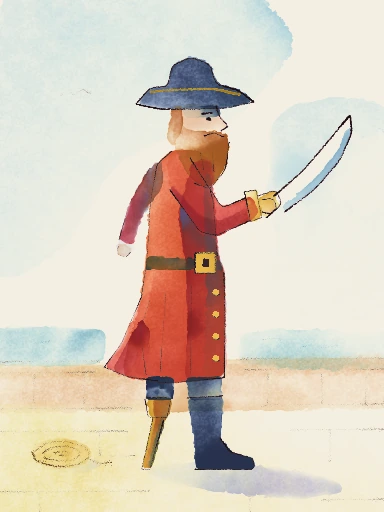
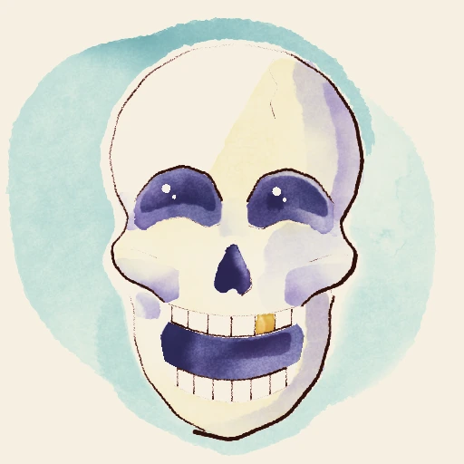
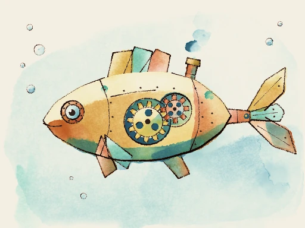
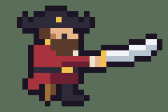
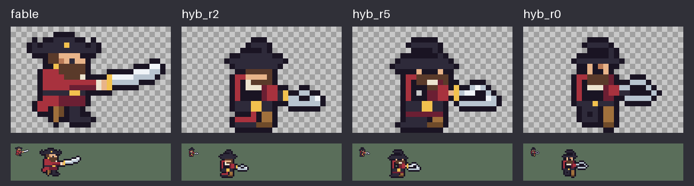
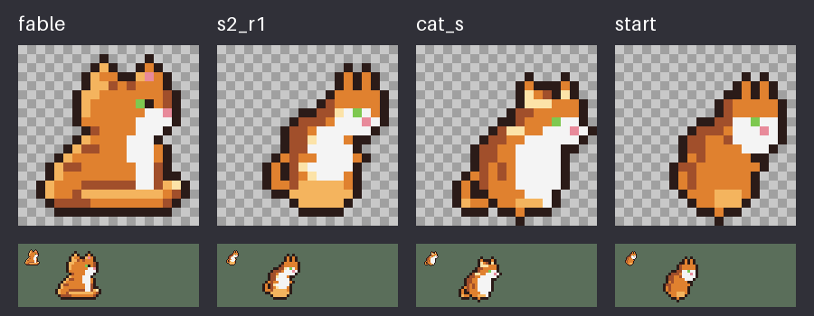

# pixelaite

Game art described as code, rendered the same way every time, and improved by an AI agent that looks at its own renders.

An agent writes a small script (Lua for pixel art, JavaScript for watercolor), renders it, reads the preview image,
critiques it against a checklist, and edits the script. The script is the asset: it is small, easy to diff,
and easy to change ("make the coat redder", "add a peg leg"). Pixel art exports to layered, tagged
[Aseprite](https://www.aseprite.org/) files.

<p>
  
  
</p>
<p>
  
  
</p>

Every image above came from one Claude agent working on its own: a written brief, at most 3 or 4 renders
for the still and at most 3 for the animation. Each run took between 1 and 6 minutes.

## What is in here

| Path | What it is |
|---|---|
| `pixelaite.py`, `px/px.lua` | Pixel art: render `assets/<name>/sprite.lua` to PNG, GIF and a critique sheet |
| `aseprite/build.lua` | Export a sprite script to a layered `.aseprite` file with frames and tags |
| `paint/` | Watercolor: render `assets/<name>/paint.js` with [p5.brush](https://github.com/acamposuribe/p5.brush) in headless Chrome |
| `CLAUDE.md` | The pixel art loop, the critique checklist and the `px` API (Claude Code loads it automatically) |
| `paint/PAINT.md` | The watercolor loop, animation rules, watercolor practice and the critique checklist |
| `.claude/skills/pixelaite/SKILL.md` | A Claude Code skill: how to run the whole loop with a subagent |
| `tools/` | Experiments: local model loops, blind tournaments, the cost ledger |
| `assets/` | The scripts and briefs of every asset we made. Renders are not committed: rebuild them |

## Setup

You need Python 3 (we used 3.14). The watercolor renderer also needs Node.js.

```sh
python -m venv .venv
.venv/bin/pip install -r requirements.txt

# Watercolor only
(cd paint && npm install)
.venv/bin/playwright install chromium   # skip this if Google Chrome is installed
```

The Lua runtime comes with the `lupa` package. You do not need a separate Lua install.

## Use it

With [Claude Code](https://claude.com/claude-code), open the folder and ask for art in plain words:

> Make a 32x32 pixel art treasure chest, front view, for an inventory icon.

> Paint a watercolor lighthouse at dusk, 512x384, and animate the light beam.

The project skill (`.claude/skills/pixelaite`) tells Claude to write a brief, hand the job to one subagent
with a render cap, and check the result. You can also run the renderers by hand:

```sh
# Pixel art
.venv/bin/python pixelaite.py new chest --size 32x32
.venv/bin/python pixelaite.py render chest       # writes assets/chest/iterations/001/
.venv/bin/python pixelaite.py aseprite chest     # needs aseprite on PATH, or ASEPRITE=/path/to/aseprite

# Watercolor
.venv/bin/python paint/render.py new lighthouse --size 512x384
.venv/bin/python paint/render.py render lighthouse
.venv/bin/python paint/render.py check lighthouse   # renders twice and compares the hashes
```

To see an existing asset, render it: for example `pixelaite.py render pirate_idle`
or `paint/render.py render fish_wc_anim`.

## How a render helps the agent see

The agent cannot look at a canvas while it draws. It only sees the preview image after a render. So the
preview is built for critique:

- **Pixel art:** the sprite enlarged on a checker background and on a pixel grid, at actual size,
  2x and 3x as players see it, and a lint report (`lint.txt`) of stray single pixels and the palette in use.
- **Watercolor:** the image, a grid with pixel coordinates every 50 px, the image at 1/2 and 1/4 size,
  and a grayscale view to check the values.
- **Animation:** every frame side by side, plus a view of what changed from frame 1.
  If the background lights up there, something flickers.

The agent names coordinates from the grid in its critique ("the buckle at 205,262 is lost"), and the next
edit is a local fix, not a rewrite.

## Watercolor that stays still

p5.brush simulates watercolor with random texture. Two changes make it usable as code that an agent edits:

1. **Per-element seeds.** Each element starts with `ctx.part("coat")`, which reseeds from the element's name.
   Without it, all fills share one random sequence, and adding one fill changes the texture of every fill
   after it.
2. **Rigid motion only.** A fill that changes its outline gets a new texture, so it flickers. Moving parts
   are drawn around their own pivot and only translated or rotated. A coat tail that bends is built from
   overlapping pieces. Steam and water may "boil" on purpose with `ctx.part("steam", ctx.frame)`.

The same script and seed give the same pixels on the same machine. Different Chrome versions may give
slightly different pixels.

## What we found

We tried several ways to split the work between models, with blind rankings by three Claude judges
(Haiku, Sonnet and Opus) at the end. The test subjects were a 20x20 sitting cat and a 30x20 pirate
with a sword and a peg leg.



- **A local model as judge does not work.** Gemma 26B (served by Lemonade) could not judge quality,
  in a pairwise format or with a yes/no checklist.
- **Local model draws, Claude judges.** The quality stayed limited by the drawer. A stronger judge
  helped only a little. A rule to keep the current best when the judge has low confidence stopped
  the sprite from drifting.
- **One strong model alone wins.** Claude Fable 5.2 at low effort with at most 3 renders was first
  for all three judges on the pirate. On the cat it had a mean rank of 1.3. It cost about $0.55
  per sprite, the same as the best hybrid run.



Costs per run, as list-price estimates from the subagent token counts (`tools/ledger.py`):

| Run | Model | Cost |
|---|---|---|
| Pixel pirate, hybrid, 6 rounds | Gemma 26B draws, Sonnet judges | $0.65 |
| Pixel pirate, alone, 3 renders | Fable 5.2, low effort | $0.54 |
| Pixel pirate idle, 4 frames | Fable 5.2, low effort | $0.54 |
| Watercolor pirate, still and loop | Fable 5.2 | $1.69 |
| Watercolor skull, still and loop | Fable 5.2 | $1.73 |
| Watercolor fish, still and loop | Fable 5.2 | $0.99 |

The detail is in `assets/_runs/ledger.csv`.

## Building Aseprite

Aseprite is paid software, but the source is available and you may build it for your own use.
We built version 1.3 on Linux with clang, ninja and the prebuilt Skia m124 from the
[Aseprite build instructions](https://github.com/aseprite/aseprite/blob/main/INSTALL.md).
The exported pirate idle opened with all 4 frames, 3 layers, the `idle` tag and an indexed palette.
It matched our renders pixel for pixel.

## Credits

- [p5.brush](https://github.com/acamposuribe/p5.brush) by Alejandro Campos Uribe, MIT license.
  `paint/p5brush-llms.txt` is its API reference, and `paint/p5brush-LICENSE.md` is its license.
- [lupa](https://github.com/scoder/lupa) runs Lua 5.4 inside Python.
- Ideas from SketchAgent (CVPR 2025) and Doodle Agent (ICCV 2025 workshop), which also let a model
  draw with code and look at the result.

## License

MIT, see `LICENSE`. This covers the code and the asset scripts in this repository.
